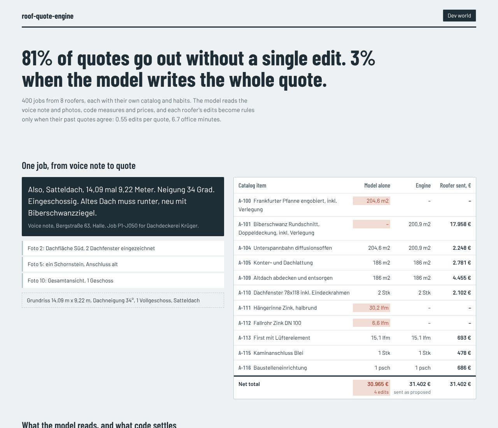

# roof-quote-engine

A roofer in Germany writes quotes in the evening: a voice note from the site visit, a few photos, sometimes the
architect's plan, and a catalog only they know how to use. This is a full-stack TypeScript engine that turns those
into a quote **priced from the roofer's own catalog**, the way **that roofer** would have written it, and learns their
habits from the edits they make before sending, without learning the wrong ones.

- **The model reads, code measures and prices.** An LLM turns the voice note and photo notes into a structured roof
  spec (Vercel AI SDK, zod schema). Dimensions come from the architect's plan (parsed by code) or a satellite
  footprint; a rough "so ungefähr zehn mal acht" is never priced, it becomes a question to the customer. Quantities are
  geometry; prices come from the catalog.
- **Each roofer's habits are learned from their edits**: scaffolding from two storeys or always, new underlay on a
  renovation or not, gutters offered when the old ones are rusted, their waste factor. A rule is kept only when
  rebuilding that roofer's past quotes with it needs fewer edits than without (a one-sided sign test). The trade's own
  words ("Doppelmulden", "Biber", "Harzer Pfanne") go into a shared glossary the same way.
- **Evals gate every change**: `scripts/evaluate.ts` compares four designs on the same jobs and luck, `scripts/gate.ts`
  fails CI when the numbers fall, and `evals/` holds a promptfoo extraction eval for the live model.

On 8 simulated roofers and 400 jobs:

- **81.3% of quotes sent without a single edit** over each roofer's last 20 jobs, against 3.1% when the
  LLM writes the whole quote and 40.6% when every edit becomes a rule.
- **0.55 edits per quote** against 4.58; median total off by 1.0% against 9.1%.
- **6.7 office minutes per quote** against 75 by hand, at €0.011 of model cost.
- **Dimensions right in 100.0% of jobs** once code settles them, against 77.0% as the model reads them; the covering
  right in 96.8% with the learned glossary against 83.5% without.



## Results on the dev world

| Design | Sent without edits | Last 20 jobs per roofer | Edits per quote | Median total error | Office minutes per quote | LLM cost per quote |
|---|--:|--:|--:|--:|--:|--:|
| LLM writes the whole quote | 5.0% | 3.1% | 4.58 | 9.1% | 18.7 | €0.039 |
| LLM reads, code measures and prices | 33.5% | 35.0% | 1.64 | 3.2% | 9.9 | €0.011 |
| + learns every edit at once | 43.8% | 40.6% | 1.22 | 2.1% | 8.7 | €0.011 |
| **+ learns habits through a replay gate** | 72.8% | 81.3% | 0.55 | 1.0% | 6.7 | €0.011 |

A quote counts as sent without edits when the roofer changed no line (quantity within 3%, same items, same prices)
and the total is within 3%.

### What the model reads, and what code settles

| Field | As the model reads it | After code settles it |
|---|--:|--:|
| length | 87.8% | 99.8% |
| width | 77.0% | 100.0% |
| pitch | 95.3% | 98.3% |
| storeys | 93.8% | 100.0% |
| family | 83.5% | 83.5% |
| skylights | 90.5% | 100.0% |
| chimneys | 99.5% | 99.5% |
| renovation | 100.0% | 100.0% |

Plans were parsed for 200 jobs, satellite footprints used for 165, and 20 questions sent to customers
(18 answered) when only a rough voice size was left.

### Habits learned per roofer (gated)

| Roofer | True habits (simulation) | Rules learned |
|---|---|---|
| P1 Dachdeckerei Krüger | waste 8%, scaffold storeys2, new underlay, offers gutters | waste on covering 8% |
| P2 Dachdeckerei Schulze | waste 12%, scaffold never, new underlay, skips gutters | leave out scaffold; leave out gutter when renovation |
| P3 Dachdeckerei Neumann | waste 8%, scaffold never, keeps underlay, skips gutters | leave out underlay when renovation; leave out scaffold; leave out gutter when renovation |
| P4 Dachdeckerei Hartmann | waste 12%, scaffold storeys2, new underlay, skips gutters | leave out gutter when renovation |
| P5 Dachdeckerei Lehmann | waste 10%, scaffold storeys2, new underlay, skips gutters | leave out gutter when renovation |
| P6 Dachdeckerei Köhler | waste 5%, scaffold always, new underlay, offers gutters | waste on covering 5%; include scaffold |
| P7 Dachdeckerei Böhm | waste 10%, scaffold storeys2, new underlay, offers gutters | defaults fit |
| P8 Dachdeckerei Franke | waste 10%, scaffold always, keeps underlay, offers gutters | leave out underlay when renovation; include scaffold |

Glossary learned across roofers: "biberschwanzziegel" = biberschwanz, "biberschwanz" = biberschwanz, "harzer pfanne" = betondachstein, "altdeutsche deckung" = schiefer, "moselschiefer" = schiefer, "biber" = biberschwanz, "betonpfanne" = betondachstein, "doppelmulden" = frankfurter pfanne, "die braas-pfanne" = frankfurter pfanne, "kronendeckung" = biberschwanz.

## Held-out world (run once)

Not run yet. `npx tsx scripts/evaluate.ts --heldout` runs it once and writes `config/heldout.lock`.

## How it is built

| Part | Files | What it does |
|---|---|---|
| Read | `src/llm/reader.ts`, `prompts/extract.md` | `generateObject` with the `JobSpec` zod schema (Vercel AI SDK, Anthropic). |
| Settle | `src/core/measure.ts` | Plan parsed by code, satellite footprint, customer question; storeys and skylights from photo notes; glossary. |
| Take off and price | `src/core/takeoff.ts`, `src/core/quote.ts` | Roof area, ridge, hips, gutters, downpipes, scaffold; lines from the roofer's catalog with their rules. |
| Learn | `src/core/learn.ts` | Evidence from each sent quote; naive or replay-gated rules; glossary. |
| Store and serve | `src/db/schema.ts`, `src/service.ts`, `src/api/app.ts` | Drizzle on Postgres (PGlite in tests); Express: `POST /jobs`, `POST /quotes/:id/sent`, `GET /partners/:id/rules`. |
| Evaluate | `scripts/evaluate.ts`, `scripts/gate.ts`, `evals/` | Designs on the same jobs; CI gate; promptfoo extraction eval. |
| Console | `web/` | React, Vite, React Query, Framer Motion. |

## Run it

```bash
npm ci && npm test                     # unit, API (PGlite) and invariant tests
npx tsx scripts/evaluate.ts            # dev world -> reports/dev.json
npx tsx scripts/gate.ts                # quality gate (config/gate.json)
npx tsx scripts/readme.ts              # README.md and the console data
ANTHROPIC_API_KEY=... npm run serve    # API with the model reader
cd web && npm ci && npm run build      # console
```

## Limits

- Roofers, catalogs, jobs and the model's mistakes are simulated, with their behaviour in `config/world.json`. The
  model reader and the promptfoo eval are written for Anthropic models and have not been run on these jobs here.
- Photo notes are text (as an image model would caption them); measuring from imagery itself is not built.
- No mobile app: the console is web only.

Repository: https://github.com/manojrevenkar12-web/roof-quote-engine
